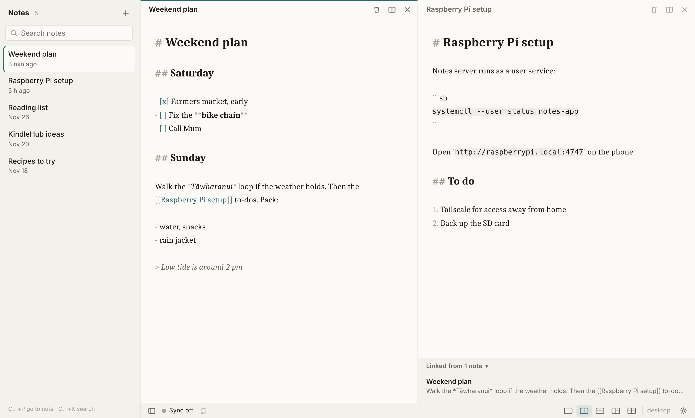

# Notes

Plain Markdown notes in a git repo, synced through GitHub. The same small app runs as a desktop app on Windows, macOS and Linux, and on a Raspberry Pi that serves it to your phone and other devices, at home or away.

- Notes are ordinary `.md` files. Any editor can read them, and there's no lock-in.
- Sync is automatic: commit, fetch, merge, push in the background. It never rebases, never leaves conflict markers in a note, and never throws away text. If the same lines changed in two places, you get both versions side by side.
- Quick switcher (Ctrl/⌘+P), full-text search, `[[wiki links]]` with backlinks, today's note, clickable checklists, and split screen up to four panes.
- Deleted notes go to a Trash you can restore from, and every note has a version history (from git) you can browse and restore.
- Works offline, including on your phone through the Pi.



## How it fits together

```
Windows / macOS / Linux ──git──┐
                               ├── GitHub (your private notes repo)
Raspberry Pi ───────────git────┘
  │  serves the same app over the network:
  ├─ at home:      http://<pi>:4747       phone, tablet, KindleHub
  └─ anywhere:     https://<pi>.<tailnet>.ts.net   (Tailscale)
```

Every machine that runs the app is an ordinary git client of your notes repo. The Pi is one of them that also serves the app to devices that can't run git. See [docs/API.md](docs/API.md) for how KindleHub syncs.

## 1. Make the notes repository (once)

Create an **empty private repository** on GitHub, e.g. `notes` (<https://github.com/new>; don't add a README). Copy its URL: `git@github.com:YOU/notes.git` (SSH) or `https://github.com/YOU/notes.git` (HTTPS).

## 2. Install

Build the package (`npm install && npm run package` → `release/notes-app-<version>.zip`) and extract it on the machine you're installing on.

### Windows

Double-click **Install Notes (Windows).cmd**. If Windows warns about an unknown publisher, choose *More info → Run anyway*.

The installer offers to install Node.js and Git with winget if they're missing. Then it adds **Notes** to the Start menu, keeps sync running in the background from login, and registers an uninstaller under *Settings → Apps*. It installs for your user only, with no admin rights. Options: `-NoStartup`, `-NoLaunch`.

When Notes opens, paste the repository URL and click **Test connection**. With an HTTPS URL, Git Credential Manager (part of Git for Windows) opens a GitHub sign-in the first time.

### Windows, portable (no install)

Build it on a Windows PC (`npm install && npm run exe` → `release\Notes.exe`, about 84 MB), then put it in any folder (or on a USB stick) and double-click it. It's a single file with everything built in, including Node.js; only **Git for Windows** has to be installed for syncing (`winget install Git.Git`). Windows may show *Windows protected your PC* the first time, because the file isn't signed: choose *More info → Run anyway*.

The first double-click starts Notes in the background and opens its window; later double-clicks just open the window. Settings and the search index are kept in a `Notes-data` folder next to the exe, so moving the folder moves everything (if that folder can't be written, the normal per-user folders are used). The notes themselves live wherever you choose during setup. To stop Notes, run `Notes.exe stop` (or sign out). It doesn't start at login by itself: for that, put a shortcut to it in `shell:startup` with the argument `--no-window`.

Use either the installer or the portable exe on one PC, not both: both use port 4747.

### macOS / Linux

```sh
./install.sh
```

Adds Notes to your applications (macOS: `~/Applications/Notes.app`; Linux: the app menu) and runs sync in the background from login (a LaunchAgent on macOS, a systemd user service on Linux). It needs git (`xcode-select --install` on a Mac). If Node.js 22.13+ is missing, the installer offers to download a private, checksum-verified copy.

### Raspberry Pi (home server)

```sh
./install.sh --server               # home network only
./install.sh --server --tailscale   # also reachable away from home (see below)
```

This asks for a password for the web UI, listens on your home network, creates an SSH key for GitHub, and starts at boot. Then, from any browser on your network, open the address it prints (e.g. `http://192.168.1.20:4747`). The setup page shows the Pi's SSH key: add it to your notes repo on GitHub (*Settings → Deploy keys → Add deploy key*, tick *Allow write access*). Then paste the repo's **SSH** URL and start.

**Raspberry Pi 2 / 32-bit OS:** Node.js 24 no longer ships 32-bit ARM builds, but Node 22 (supported until April 2027) does, and Notes runs on it. If the Pi's Node is missing or too old, the installer fetches Node 22 for the Pi automatically. Notes used about 65 MB of memory with 300 notes in testing, so it fits alongside other services on a Pi 2's 1 GB.

### Uninstall

Windows: *Settings → Apps → Notes → Uninstall*. Elsewhere: `./uninstall.sh`. Your notes folder and settings are kept.

## 3. Reaching the Pi from outside home (Tailscale)

[Tailscale](https://tailscale.com) puts your devices on a private network that works from anywhere, with no port forwarding and nothing exposed to the internet.

1. Install Tailscale on the Pi (`curl -fsSL https://tailscale.com/install.sh | sh`, then `sudo tailscale up`) and on your phone/laptop, signed in to the same account.
2. In the Tailscale admin console, turn on **MagicDNS** and **HTTPS certificates** (*DNS* page).
3. On the Pi: `./install.sh --server --tailscale` (or, if it's already installed: `tailscale serve --bg 4747` and add the Pi's `*.ts.net` name under *Settings → Access → Tailscale name(s)*).

Then open `https://<pi-name>.<your-tailnet>.ts.net/` from anywhere. It's real HTTPS, so on a phone you can "Install app" / "Add to Home Screen" for a full-screen app. The password still applies.

Don't forward port 4747 on your router, and don't use `tailscale funnel` (that publishes to the whole internet).

## Using it

| | |
| --- | --- |
| Go to a note (fuzzy) | **Ctrl/⌘+P**. Type part of a title; Enter opens, Ctrl/⌘+Enter opens to the side, Shift+Enter creates a note with that title |
| New note | **Alt+N**, or **+** in the sidebar |
| Today's note | **Alt+D**, or the calendar button: opens (or creates) a note titled with today's date |
| Checklists | `- [ ] item` shows a checkbox; click or tap it to tick |
| Search inside notes | **Ctrl/⌘+K** |
| Link to a note | type `[[` and pick a title. `[[Title|shown text]]` and `[[Title#Heading]]` work too |
| Follow a link | **Ctrl/⌘+click** it (or **Alt+Enter** with the cursor on it). A link to a note that doesn't exist yet (dashed) creates it |
| Backlinks | "Linked from N notes" under each note |
| Split screen | **Ctrl/⌘+\\**, Ctrl/⌘+click a note, or the layout buttons at the bottom right. **Alt+1…4** focuses a pane, **Alt+W** closes it |
| Delete / Trash | the bin button on a note moves it to the **Trash** (Undo in the message that pops up). The bin button in the sidebar opens the Trash: preview, restore, or delete forever. The Trash syncs to all your devices |
| History | the clock button on a note: every synced version, with what restoring it would change. Restoring is an ordinary edit (Ctrl/⌘+Z undoes it) |
| Appearance | the palette button at the top right: 16 themes (or Automatic, following your system's light/dark), note font, interface font, line spacing and width, borders (none / subtle / strong / cards), corners, spacing, line numbers, current-line highlight, spell check, animations. Saved per device |
| Text size | the **− 100% +** control at the top right, or **Ctrl/⌘ +**, **Ctrl/⌘ −**, **Ctrl/⌘ 0** |
| Settings | **Ctrl/⌘+,** or the gear at the bottom right |
| Save / sync now | **Ctrl/⌘+S** / the ↻ button (both happen automatically) |

Notes save as you type and sync about 8 seconds after you stop typing, every 3 minutes, when the window gets focus, and on exit.

Links point at a note's **title** (its first `# Heading`). Renaming a title doesn't update links to it; the old ones show as dashed (missing) until you fix them.

**Conflicts:** if a note was changed in two places, the version you were editing stays in the note and the other one is saved next to it as `name (conflict 2026-11-27 laptop).md`. A banner lists these. Click one to open it beside the original, copy across what you want, then press **Done, move copy to Trash**.

**Offline:** on the desktop, and on a phone using the Pi's `https://…ts.net` address, the app keeps working without a connection. It opens, shows your notes (it keeps a copy of each), and keeps what you type until it can save. Over plain `http://` on the home network, browsers don't allow this, so use the Tailscale address on your phone.

**Size limits:** a single note can be up to 2 MB. Files over 5 MB in the notes folder (videos, archives…) are never synced, so they can't bloat the repository; the status bar lists any it skipped.

**Passwords:** after 5 wrong passwords from one device, that device has to wait 30 seconds, doubling with each further miss (up to 15 minutes).

## Settings

Everything is in the Settings dialog: notes folder, repository URL (with a connection test), sync timing, branch, this machine's name, who can connect (this computer / home network), Tailscale names, and the password. Changes apply immediately, except the network address and port, which apply after a restart.

Where things live:

| | Windows | macOS | Linux / Pi |
| --- | --- | --- | --- |
| Settings | `%APPDATA%\notes-app\config.json` | `~/Library/Application Support/notes-app/config.json` | `~/.config/notes-app/config.json` |
| Search index, log | `%LOCALAPPDATA%\notes-app` | `~/Library/Application Support/notes-app` (log: `~/Library/Logs/notes-app.log`) | `~/.local/share/notes-app` |
| Program | `%LOCALAPPDATA%\Programs\notes-app` | `~/Library/Application Support/notes-app/program` | `~/.local/share/notes-app/program` |

The search index is disposable and rebuilds itself if deleted. Window layout is remembered per browser.

### Command line

The installers add a `notes-app` command (Windows: `node "%LOCALAPPDATA%\Programs\notes-app\server.js"`):

```
notes-app                  run the server in the foreground (logs to the terminal)
notes-app launch           start it in the background if needed and open the app window
notes-app stop             stop it (after a final sync)
notes-app set-password     set the web UI password
notes-app configure ...    save options, e.g. --port 4800 --machine-name laptop
notes-app --help           all options
```

## Development

```sh
npm install
npm run build              # dist/: server.js + web/ (all the server needs; no runtime npm deps)
node dist/server.js --repo /tmp/test-notes --no-sync --open
npm run typecheck
npm test                   # unit + sync scenarios with real git in temp repos
npm run test:ui            # end-to-end in headless Chrome; screenshots in tests/ui/screenshots
npm run package            # release/*.zip and *.tar.gz with the installers
npm run exe                # release/Notes.exe (on Windows) or release/notes: portable single executable
npm run release            # all of a release in one go: package + exe + test:exe (run on Windows for Notes.exe)
```

**Making a release (on the Windows PC):** bump `version` in `package.json`, then `npm install && npm run release`. `release/` then holds `notes-app-<version>.zip` and `.tar.gz` (installers for every OS) and `Notes.exe` (portable Windows app), and the exe has passed its smoke test. Each step only replaces its own files, so the order doesn't matter.

`npm run exe` uses Node's [single executable applications](https://nodejs.org/api/single-executable-applications.html) feature: it bundles the server as CommonJS, embeds `dist/web/` as assets, injects both into a copy of the running `node` binary with `postject`, sets the icon and version with `rcedit`, and marks the exe as a windowed app so no console opens (`--console` keeps one, for debugging). A Windows exe has to be built on Windows (macOS/Linux builds a `release/notes` for that OS). `npm run test:exe` then runs the built exe through launch → setup → new note → sync → stop, using port 4799 and a temp folder.

There is no CI: builds and tests are run by hand. Before a change is done, run `npm run typecheck`, `npm test` and (for UI changes) `npm run test:ui`; after touching the exe or installers, also build and try them on the OS concerned (`npm run exe && npm run test:exe`, or install → launch → uninstall).

The design, decisions and remaining work are in [HANDOVER.md](HANDOVER.md). The HTTP API and the sync protocol for non-git clients are in [docs/API.md](docs/API.md).
